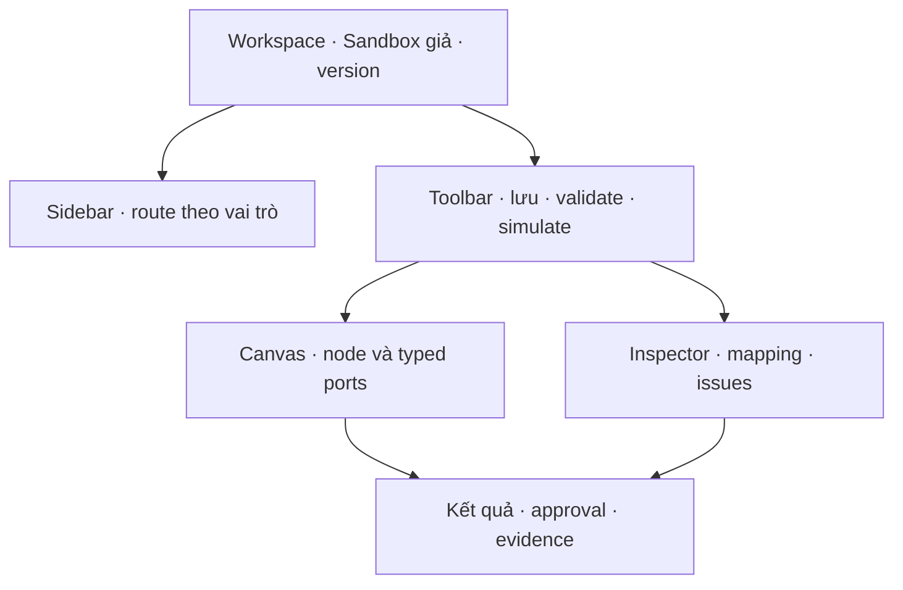

# UX-01/S1 — Wireframes và user journeys

## Desktop và mobile

Desktop Builder: header hiển thị tên workflow, draft revision và trạng thái lưu. Toolbar gồm fork, compare, Save draft, Validate, Simulate, Request approval và Activate với lý do khóa. Palette trái thêm node, Canvas giữa, Inspector phải có tab Config / Mapping / Issues. Canvas zoom và reorder có nút, thao tác drag là tùy chọn. Issues dẫn focus đúng node/field, mô tả cách sửa. Kết quả simulation mở panel phía dưới có digest version, env giả, timeline và chỉ số đếm rõ phạm vi.

Mobile Builder: workflow list → version summary → ordered node list. Từng row hiện loại node, trạng thái và số lỗi, mở editor toàn màn. Dùng “Nối cổng” chọn node/port đích và mapping form, “Lên/Xuống” cho preference thứ tự hiển thị. Thanh dưới giữ Save / Validate, Simulate và approval ở menu Hành động. Lý do Activate disabled là đoạn hiển thị cạnh control, có thể đọc bằng bàn phím. Các màn hình khác dùng bố cục trong đặc tả. [Màn hình, roles và control IDs](ux01-operator-console.md).

## Node editor và typed ports

| Node | Input → output | Editor và validation |
| --- | --- | --- |
| Trigger | none → Event<T> | Manual fixture hoặc schedule draft; timezone bắt buộc nếu lịch, schedule thật khóa |
| Agent Task | Event<T>/Object<T> → TaskResult<T> | Chọn agent/capability, input schema, deadline, correlation và scope |
| Connector | Object<T> → ConnectorResult<T> | Fixture alias, action read/write, capability/consent, cost model và idempotency key |
| Human Approval | ApprovalRequest<T> → approved/rejected/expired | Action + digest + environment + ngân sách/time window; reject/expire dẫn Stop |
| Condition | Object<T> → đúng/sai | Predicate typed và nhánh mặc định cho null/unknown |
| Delay/Retry | RetryableFailure → RetryDecision | Delay, max attempts, deadline; server không cho retry dispatch khi outcome_unknown |
| Receipt/Evidence | Outcome<T> → ReceiptRef | Binding job/task/run/correlation/digest, schema callback và evidence policy |
| Stop/Rollback | StopReason → Terminal hoặc RollbackRequest | Ghi reason; rollback request có ownership và approval riêng, không trực tiếp chạy |

Port DTO có `port_id, direction, type, schema_ref, cardinality, required`. Edge có source/target node+port và mapping field path; chỉ dùng mapping typed cho trường allowlisted, không thực thi biểu thức tùy ý. Required input phải mapped hoặc có default hợp schema, port single chỉ nhận một nguồn, incompatible type và dangling edge báo lỗi. Mỗi node lỗi có issue code, label, focus target và copy an toàn.

Lifecycle thao tác: New/fork → Save draft (ETag) → Validate snapshot → Simulate đúng digest → Request approval nếu cần → Activate sau server decision. Mọi edit làm stale Validate/Simulate/approval cũ. Phiên bản active về sau là immutable. Từ chối cycle tại DAG, gồm self-loop; retry mô hình hóa chính sách có giới hạn trong node, giữ audit từng attempt. Validator còn chặn missing access/connection, unapproved/unknown costs, side effect thiếu idempotency, sai callback shape/binding và dispatch retry khi unknown. Request activation bị khóa trong S1; policy chưa có, expired, stale hay backend 503 đều hiện GateReason. Không cho một đường bypass bằng URL hoặc phím tắt.

## Năm journeys

| ID | Màn hình / actor / input | Action và gate | Error / acceptance khi đi hết |
| --- | --- | --- | --- |
| J1 | Dashboard → Workflows → Builder → Runs / Operator / Event<OrderSample> giả | Tạo Trigger → Agent Task → Connector fixture → Receipt. Map order_id, save v1, validate, simulate. Kiểm scope draft/simulate, sandbox và zero cost | Thiếu quyền: 403; mapping sai: 422 focus field. DAG hợp lệ và có receipt mock cùng version/digest. Activate hiện disabled. |
| J2 | Runs → Timeline → Receipt → Reconciliation / Operator / run giả đã timeout sau dispatch | Đọc outcome_unknown, receipt và late disputed signal. Gửi yêu cầu reconcile trong scope; Retry dispatch khóa kể cả qua command forced. Replay hợp lệ chỉ đọc hoặc gửi lại cùng callback qua server policy | Invalid callback binding: 409, không đổi record. Unknown retry: 409, bộ đếm dispatch giả giữ 1. Original outcome giữ nguyên, resolution review hiện riêng. |
| J3 | Content → Preview → Approvals / Operator và Reviewer khác nhau / draft media giả v3 | Operator yêu cầu review. Reviewer đọc diff, duyệt đúng digest/action content.review, giới hạn chi phí 0 và cửa sổ duyệt giả hợp lệ | Hết hạn hoặc đổi digest/budget: yêu cầu duyệt lại. Draft đạt “Đã duyệt nội dung”. Publish vẫn locked vì action, consent và approval riêng. |
| J4 | Connections → GA4 / Admin / alias giả và quyền read-only | Chọn GA4 fixture, xem operation read và lưu proposal sandbox. Capability có DOCUMENTED + UNVERIFIED_ACCOUNT_ACCESS. Consent production chưa có | Không verified source: nút OAuth/Verify live disabled và giải thích. Proposal không gửi OAuth, lưu token hay yêu cầu dữ liệu thật. |
| J5 | Monitoring → Incident → Runbook / Operator / giả lập readiness 503 ×3, health 200, Hermes dashboard 200; backup 216 h > 192 h | Xem samples cùng origin, nhận incident, ghi đọc state/container và chuyển Codex. Backup chuyển Hostinger Agent + Điều phối. Đóng readiness khi 200 ×3, không restart/OOM mới. Đóng tuổi backup khi metadata mới đạt, giữ restore UNKNOWN | Mẫu recovery thiếu: giữ incident mở, lý do rõ. Kết luận tách readiness, dashboard và restore. Không restart/restore hay gửi alert thật. [WS-02](https://github.com/DuyKienTTD/Hosting/pull/8) |

## Acceptance checklist cho triển khai tiếp theo

- A1. Xem 360/768/1280 px và zoom 200%. Không mất action/label, phần canvas có vùng cuộn riêng, mobile list hỗ trợ toàn bộ thao tác builder, không cần kéo thả.
- A2. Keyboard-only: skip link, tab theo thứ tự, Enter/Space kích hoạt control đúng role, Esc đóng modal và focus về trigger, reorder/connect qua nút. Focus visible, lỗi được thông báo và dẫn tới field. Label/aria-describedby cho scope, disabled reason, input và thông báo động; trạng thái có chữ, không phụ thuộc màu.
- A3. Một tiêu đề chính, heading thứ bậc, contrast mục tiêu WCAG AA (4,5:1 chữ thường, 3:1 chữ lớn/biên focus), target cảm ứng mục tiêu 44 px. Kiểm screen reader trên list và inspector; dùng announcement tiết chế, không đọc lại toàn timeline.
- A4. Empty/loading/error/blocked/stale ở mỗi route dùng DataState; phiên không scope nhận safe error và không thấy dữ liệu ngoài scope.
- A5. Chạy J1–J5 và N1–N5 trên mock, đối chiếu các IDs control ở bảng khả thi. Server tests sau triển khai kiểm riêng authorize, idempotency, callback, approval binding, immutable audit và fail-closed activation.
- A6. Evidence, badges và môi trường đều có nguồn, thời điểm, phạm vi. KPI chưa chốt mang PROVISIONAL_BIZ02. Không biểu diễn external auth hoặc runtime giả thành verified thật.

Các kiểm tra layout, keyboard và screen reader ở S1 là walkthrough đặc tả; kiểm trên trình duyệt là acceptance của frontend tương lai.
