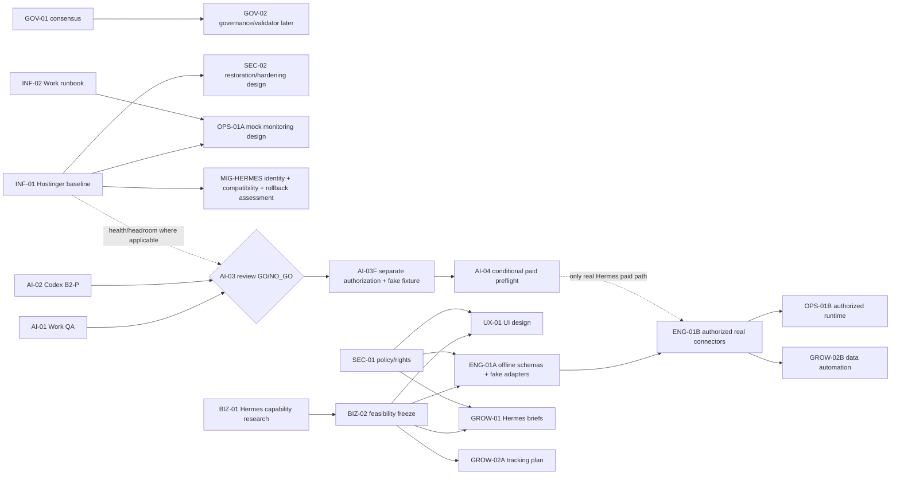

# DRAFT — Kế hoạch công việc tổng thể và phân bổ theo năng lực Agent

**Base snapshot của đợt thẩm định:** `main@a22516aa9e5940baccc37ab2edf9eeed2ccc3d93` (23/11/2026). **Sau ACK, main đã tiến tới `e385c1bea2070973e3007e5717f7e980348d6ab3`**, chứa Hostinger report; PR #6 vẫn có base SHA cũ, phải reconcile drift trước merge. **Chưa được các Agent xác nhận. Không phải phê duyệt triển khai production hoặc paid API.** ChatGPT chịu trách nhiệm hợp nhất; từng tác nhân chỉ xác nhận phần thuộc năng lực/quyền phiên của mình. Chủ dự án phê chuẩn baseline cuối cùng sau vòng đối chiếu.

## 1. Mục tiêu và nguồn

Mục tiêu: nhìn thấy **toàn bộ việc còn phải làm**, tránh giao trùng; mỗi việc có owner duy nhất, cộng tác viên, mức sẵn sàng, dependency, khả năng song song, điểm nghiệm thu và link evidence. Chia tải theo **năng lực phù hợp và dung lượng thực tế đã ACK**, không chia đều số task một cách cơ học.

Nguồn bắt buộc: [PROJECT](../PROJECT.md), [GOALS_AND_ROADMAP](../GOALS_AND_ROADMAP.md), [Operating Plan](2026-11-21-repository-operating-plan.md), [STATE](../STATE.md), [CATALOG](../CATALOG.yaml), [AGENTS](../AGENTS.md), [Workflow §§7–10](../rules/AGENT_WORKFLOW.md), [Security](../rules/REPOSITORY_SECURITY.md), [Agent directory](../agents/README.md), [ADR-P0-003](../decisions/2026-11-21-hermes-gate-b-single-paid-call-proposal.md). Các task đã tồn tại là nguồn điều khiển chi tiết; tài liệu này là **portfolio index**, không ghi đè quyền hoặc status của task gốc. Trước khi ACK, mỗi Agent phải fetch **main + PR heads mới nhất**, đọc đủ các tài liệu liên quan, nêu SHA/độ lệch với snapshot và không lấy snapshot làm bằng chứng live.

## 2. Phạm vi và cấu trúc hệ thống

**Giai đoạn 0** (21/11–05/12/2026): governance, capability, health baseline, topology, an toàn, chuẩn bị hợp đồng tích hợp. **Giai đoạn 1** (06/12/2026–04/01/2027): reliability, monitoring, backup/restore an toàn, idempotency/error handling. **Giai đoạn 2** (05/01–19/02/2027): media, Ads, website/SEO, đa kênh, báo cáo đo lường và workflow kinh doanh. Đây là khung mục tiêu từ roadmap, **không phải cam kết tiến độ**; kiểm tra dependency và năng lực thực tế trước khi xếp lịch.

Năm workstream đang có: **WS-01 governance; WS-02 infrastructure reliability; WS-03 AI integration; WS-04 website/content/media/growth; WS-05 security/data governance**. Thêm một lớp năng lực dùng chung: **UI/operator console** là đề xuất thuộc WS-03/WS-04, chưa có task/approval triển khai.

Phân biệt: **Hermes Agent WebUI** (có công cụ và đã thử GitHub) khác **Hermes auxiliary/runtime production** (chưa có paid E2E hoàn tất); **Hostinger Agent** khác nền tảng Hostinger; **n8n không phải AI Agent**, là execution plane cần owner kỹ thuật quản lý. **ChatGPT Work** là môi trường tác vụ trong ChatGPT, chưa có hồ sơ năng lực/ACK riêng trong repo; phân công dưới đây là **provisional**, phải tự xác minh phiên GitHub, quyền đọc/ghi và giới hạn.

## 3. Bản đồ năng lực — tổng hợp ACK theo bằng chứng

Cả ba phản hồi đã đọc bản `PR6@e5f702e`. Nguồn: [Codex ACK](https://github.com/DuyKienTTD/Hosting/pull/6#issuecomment-7089255768), [Work ACK](https://github.com/DuyKienTTD/Hosting/pull/6#issuecomment-7089269400), [Hermes report](https://github.com/DuyKienTTD/Hosting/blob/45b4032bb2f57e779a22d62f505ebefb387f29c9/reports/2026-11-23-hermes-pr6-master-allocation-review.md). **ACK là cho việc thẩm định tài liệu**, không phải ACK thực thi các task được liệt kê.

| Agent | Năng lực phù hợp / phạm vi đã nhận | Giới hạn / tải đã ACK | Trạng thái |
|---|---|---|---|
| ChatGPT Điều phối | Governance, mục tiêu/KPI, phân loại dữ liệu liên kênh, nghiệm thu, quyết định AI-03 | Không tự chạy nền hoặc có quyền VPS; không tự duyệt tác động chi phí/production | AUTHOR_INTEGRATING |
| Codex | AI-02/B2-P candidate fake và code review; ENG-01 adapter/mock; OPS-01 sandbox kỹ thuật, validator sau khi có suất | **1 gói kỹ thuật active/phiên** hoặc 1–2 việc đọc nhỏ; KVM2 read permission chưa kiểm trong review; không tự QA độc lập mã của mình | ACK_ACCEPT_WITH_CHANGES |
| Hermes WebUI | BIZ-01 discovery, GROW-01 briefs/drafts, semantic review, nghiên cứu tools và reporting | **1 gói chính** hoặc 1 gói + 1 consult nhỏ; không live connector, publish, paid inference hay hPanel | ACK_ACCEPT_WITH_CHANGES; report commit `45b4032` |
| ChatGPT Work | AI-01 QA độc lập, INF-02 runbook, sau đó UX/GOV/QA/tracking plan khi có suất | **1 review chính + 1 deliverable đọc/draft hẹp/phiên**; GitHub read/comment đã kiểm trong review; chưa có quyền KVM2/hPanel; cần lưu capability theo phiên, survey repo riêng chưa có | ACK_ACCEPT_WITH_CHANGES |
| Hostinger Agent | INF-01 read-only; SEC-02 design; OPS-01A health/SLO/triage design; MIG-HERMES identity/compatibility/rollback assessment | **1 gói hạ tầng active + tối đa 1 draft nhỏ/phiên**; không restore, migration execution, paid, service change, background SLA | ACK_ACCEPT_WITH_CHANGES |
| n8n (thành phần) | Webhook/schedule/runtime state khi workflow được triển khai | Không phải AI Agent; Codex sở hữu phần kỹ thuật, không có chữ ký agent | NOT_APPLICABLE |

**Giải quyết bất đồng GOV-02:** Codex đề xuất tách tài liệu governance (ChatGPT) và validator thực thi (Codex khi rảnh); Hermes đề xuất Codex primary cho validator/CI. Do đó coi GOV-02 là **portfolio umbrella**, owner ChatGPT cho scope/acceptance, owner Codex chỉ cho **gói kỹ thuật validator** khi có slot, Work reviewer độc lập theo phiên. Không tạo task kỹ thuật mới từ bảng này.

**Work capability:** ACK trực tiếp 23/11 đã chứng minh quyền đọc và bình luận GitHub, năng lực rà soát tài liệu và tự xác nhận công suất tại phiên đó. Không còn coi Work là `PENDING_AGENT_ACK`; việc thiếu hồ sơ capability bền vững trong repo vẫn là gap GOV-01. Quyền hay capacity phiên tiếp theo phải kiểm lại.

## 4. Master backlog đã điều chỉnh sau phản biện

**Quy tắc mỗi dòng:** `source` là path task đã tồn tại hoặc `NO_TASK_YET` (portfolio, không phải ready implementation). **Owner dưới đây là phân bổ kế hoạch, không thay đổi owner/status metadata task gốc.** Phải tạo handoff riêng và có ACK thực thi trước khi coi một công việc đang chạy. Không sinh task mới cho những phần Gate B, WS-02 đã được đặc tả.

| ID | Đầu ra chính và nguồn (existing_task_path hoặc NO_TASK_YET) | Owner kế hoạch / hỗ trợ | Phụ thuộc để bắt đầu hoặc nghiệm thu | Nhịp / trạng thái |
|---|---|---|---|---|
| GOV-01 | Đồng thuận master allocation, kiểm đủ task/CATALOG, capability log; `tasks/2026-11-23-multi-agent-master-allocation-review.md` (PR #6) | ChatGPT / tất cả | Phản hồi Hostinger để chốt; 3 ACK đã nhận | W0 IN_PROGRESS_PLAN; chưa merge |
| GOV-02 | Metadata/traceability vs validator/CI: `tasks/2026-11-21-repository-operating-plan.md` (scope cha); gói validator `NO_TASK_YET` | ChatGPT governance / Codex technical khi có slot; Work QA | GOV-01; GitHub controls cần kiểm quyền riêng | W1 draft; không lấn AI-02 |
| INF-01 | Baseline hPanel VPS, Docker, TLS, firewall, backup: `tasks/2026-11-22-hostinger-ws02-infrastructure-baseline.md` | Hostinger Agent | Quyền hPanel read-only trong phiên, ACK thực thi | W0 PREPARED |
| INF-02 | Monitoring/triage runbook + 3 ca giả: `tasks/2026-11-22-work-ws02-monitoring-and-triage.md` | Work | Work capacity: sau/nhẹ cùng AI-01; không chờ INF-01 | W0 PREPARED |
| AI-01 | Work O1–O4 QA B2-O: `tasks/2026-11-22-work-b2-n-independent-contract-qa.md`, [PR #4](https://github.com/DuyKienTTD/Hosting/pull/4) | Work / ChatGPT nghiệm thu | `d95f161` và review findings PR #5; không rerun B2-N | W0 ưu tiên Work; verdict runtime PENDING |
| AI-02 | B2-P preflight chỉ đọc + fake-only candidate: `tasks/2026-11-21-hermes-gate-b-one-shot-paid-e2e.md`, [PR #5](https://github.com/DuyKienTTD/Hosting/pull/5) | Codex / Hostinger hỗ trợ baseline | Triaging 3 findings PR #5; quyền KVM2 nếu cần; không apply | W0 PREPARED; Codex slot kỹ thuật |
| AI-03 | Quyết định GO/NO_GO cho fixture KVM2 fake: `tasks/2026-11-21-hermes-gate-b-one-shot-paid-e2e.md` (milestone điều phối, không task mới) | ChatGPT / Work reviewer | AI-01 verdict + AI-02 evidence + health/headroom hiện hành phù hợp từ INF-01 hoặc nguồn đã kiểm | W1 WAITING_EVIDENCE |
| AI-03F | **Milestone tách biệt**: nếu AI-03 GO, fixture KVM2 fake-only và rollback, theo task Gate B hiện hữu, **cần scope/approval riêng** | Codex / ChatGPT review | AI-03 GO + preflight + quyền/runtime ownership/rollback | CONDITIONAL_NOT_AUTHORIZED_BY_PLAN |
| AI-04 | Real IPC/ledger/Guard/paid Hermes preflight qua Gate B gốc: `tasks/2026-11-21-hermes-gate-b-one-shot-paid-e2e.md`; Guard hardening liên quan `tasks/2026-11-21-hermes-gate-b-guard-transaction-hardening.md` | Codex kỹ thuật / ChatGPT gate; Hostinger/Hermes tư vấn | AI-03F nếu được mở, ADR-P0-003, mọi cost/safety/credential gates | BLOCKED_PREFLIGHT; không phát sinh paid |
| MIG-HERMES | Kiểm kê danh tính nguồn/đích Hermes, compatibility, rollback/data-loss và điều kiện di trú: existing task: `tasks/2026-11-23-ttdnew-hermes-vps-migration.md` (main@e385c1b); status=`blocked`, review-only | Hostinger Agent **assessment only** / Codex review kỹ thuật, ChatGPT quyết định | Kiểm chứng source/target identity, inventory, backups/compatibility; execution cần approval và task scope riêng | W0/W1 read-only, **migration execution BLOCKED** |
| SEC-01 | Threat model, phân loại dữ liệu, RBAC, retention/consent: `NO_TASK_YET` (dùng security review hiện có) | ChatGPT policy/data / Hostinger hạ tầng sau ACK; Codex application consult, Work QA | Tài liệu bảo mật hiện hành; read-only draft có thể làm sớm | W1 song song |
| SEC-02 | Hardening và restore/backup không phá hủy: `NO_TASK_YET` | Hostinger Agent đề xuất / Codex technical review | INF-01, phần SEC-01 liên quan; approval riêng trước live restore/hardening | W2, chưa quyền thực thi |
| BIZ-01 | Kênh Ads/GA4/WordPress/WooCommerce/email/Reach/YouTube/TikTok/Meta/media, capability + scope: `NO_TASK_YET` | Hermes discovery/draft / Hostinger WordPress metadata | Sources/docs, no account write; connector live chưa verified | W0 độc lập; Hermes đã nhận phù hợp về năng lực |
| BIZ-02 | Use-case/ROI/KPI, business priority và audience: `NO_TASK_YET` | ChatGPT / Hermes | Có thể draft từ PROJECT; khóa feasibility sau BIZ-01 | W1 draft song song |
| UX-01 | Operator UI, permissions/approval/agent flow, mock: `NO_TASK_YET` | ChatGPT user stories / Work thiết kế khi có slot, Codex feasibility | GOV-01, BIZ-02 user stories; SEC-01 permission gate khi chốt | W1 draft; Work chưa nhận thêm slot |
| ENG-01A | Connector contracts, schema, durable state, idempotency, fake adapters: `NO_TASK_YET` | Codex / Hermes semantics, Work independent QA | BIZ-02 use-case input, SEC-01 safety; **KHÔNG** cần AI-04; Codex slot sau AI-02 hoặc handoff phù hợp | W1/W2 OFFLINE_DESIGN_PERMITTED_AFTER_TASK |
| ENG-01B | Các connector/real Hermes route, account IO: `NO_TASK_YET` | Codex / owner tài khoản | ENG-01A, từng connector scope/consent/approval; **chỉ** tuyến dùng paid Hermes cần AI-04 | W2 CONDITIONAL; không account write |
| GROW-01 | Media/SEO/social content brief, editorial QA, rights/publish gates: `NO_TASK_YET` | Hermes discovery/draft / ChatGPT business review | Draft được từ BIZ-02; SEC-01 rights/consent trước khi sẵn sàng publish | W1 độc lập, không render/publish |
| GROW-02A | Event dictionary, attribution/UTM, consent, tracking plan + mock report: `NO_TASK_YET` | ChatGPT / Work khi có slot, Hermes support | BIZ-02, BIZ-01 feasibility cho kênh; không cần ENG-01 | W1 offline draft |
| GROW-02B | Scheduled attribution/report pipeline qua dữ liệu thật: `NO_TASK_YET` | Codex / Work QA | ENG-01B hoặc connector read đã duyệt, account scope/consent, rollback | W2 CONDITIONAL |
| OPS-01A | SLO proposals, cảnh báo/incident runbook, health/alert mock: `NO_TASK_YET` (tận dụng INF-02) | Hostinger hạ tầng sau ACK / ChatGPT review; Work runbook | INF-02, historical signal; chưa cần ENG-01 | W1 offline |
| OPS-01B | Monitoring/scheduler/replay và escalation live: `NO_TASK_YET` | Codex kỹ thuật / Hostinger hPanel operations | INF-01 và fresh baseline, ENG-01 nếu giám sát callback, change approval + rollback | W2 CONDITIONAL |
| QA-01 | Review độc lập đúng SHA/environment theo mỗi release: `NO_TASK_YET` (QA hiện hữu AI-01 là phần cụ thể) | Work theo slot / ChatGPT review chỉ khi độc lập tác giả | Deliverable tương ứng; không QA cùng mã tự viết, không rerun PASS thiếu change trigger | Theo release, tránh lấp slot Work |

### Đối chiếu task và trạng thái còn lệch

- Ba Agent đã cùng chỉ ra **17 task path tại snapshot main vs 15 path được index**. Kiểm tra file `CATALOG.yaml` xác nhận thiếu đúng hai đường dẫn: `tasks/2026-11-21-repository-operating-plan.md`, `tasks/2026-11-21-hermes-gate-b-guard-transaction-hardening.md`. Chỉ cập nhật CATALOG/STATE/CHANGELOG ở bước hợp nhất đã kiểm diff; **không tạo task thay thế**.
- `B2-M` có evidence canary fake PASS trong STATE nhưng task metadata Work chưa đồng bộ; không giao lại canary chỉ vì index cũ. P0 Level 1 structural PASS không đồng nghĩa toàn task gốc complete; Provider E2E PASS khác Hermes real paid E2E đang blocked.
- Guard hardening `ready_for_code_and_mock` có phần lịch sử đã được remediation/H6 thực hiện. Codex đối chiếu residual theo diff, không chạy lại luồng đã PASS nếu không có delta.
- ENG-01 cần test delta worker restart khi job ở `working/sending`; B2-N restart Hermes và B2-O restart receiver không tự chứng minh nhánh này. Đưa vào acceptance của ENG-01A/B khi thực sự triển khai.
- WS-02/GATE B có task gốc; các dòng `NO_TASK_YET` chỉ là đề mục kế hoạch, không được coi là READY_EXECUTION.

## 5. Dependency graph đã nới khóa paid



**Đường găng duy nhất của Gate B:** PR #5 finding disposition + B2-P preflight + Work O1–O4 + relevant headroom → AI-03 decision → nếu GO, AI-03F fake fixture **riêng có gate** → AI-04 mới xét real preflight. Đây không phải blocker cho ENG-01A, UX offline, Hermes briefs hoặc GROW-02A.

**Wave W0 khả thi về nội dung:** GOV-01, AI-01, AI-02, INF-01, INF-02, BIZ-01. Work có **AI-01 là nhiệm vụ chính**, INF-02 có thể là deliverable phụ hẹp; không xếp GOV-02/UX-01/GROW-02A/QA-01 vào active queue Work cùng lúc. Codex chỉ có AI-02 active package; ENG-01A/validator được xếp kế tiếp theo slot. Hermes có BIZ-01 phù hợp, GROW-01 không buộc phải active cùng lúc.

**Wave W1 có thể soạn sớm:** SEC-01, BIZ-02 draft, GROW-01 brief, UX user stories, ENG-01A architecture design, GROW-02A measurement plan, OPS-01A mock alerting. Chỉ task nào đã có đặc tả/ACK mới chuyển từ plan sang execution.

**Wave W2:** AI-03F, AI-04, SEC-02 live drill, ENG-01B, OPS-01B, GROW-02B. Mỗi hoạt động side-effect cần preflight/approval riêng, không lấy wave làm ủy quyền.

## 6. Cân tải và quyền sở hữu

- **Codex:** 1 gói kỹ thuật chính/phiên, không đồng thời AI-02 + ENG-01B + OPS-01B + GOV-02 CI. Chỉ nhận gói mới khi slot trống hoặc chủ động đổi ưu tiên có ACK. Reviewer phải độc lập với implementer.
- **Work:** 1 review chính (AI-01) + 1 deliverable đọc hẹp (INF-02). UX/GOV/QA/GROW sau đó, không biến Work thành nút nghẽn mới.
- **Hermes:** 1 package discovery/draft chính (BIZ-01), tối đa 1 consult nhỏ nếu phù hợp; GROW-01 có thể lấy dữ liệu BIZ-01 sau milestone khả dụng.
- **Hostinger:** đã ACK năng lực INF-01 read-only, SEC-02 design/review, OPS-01A health/triage design và MIG-HERMES assessment **chứ không triển khai**; tối đa 1 gói hạ tầng active + 1 đầu ra nhỏ không tranh runtime, không SLA/background. Không giao bốn gói active đồng thời. INF-01 ưu tiên; các mục tiếp theo xếp theo input trực tiếp và slot.
- **ChatGPT:** giữ plan/KPI/data policy/approval coordination; không nhận phần shell/Compose/hPanel hoặc tự nhận quyền triển khai.
- **Khả năng song song dựa trên quyền và write-set, không phải ép cân bằng theo số dòng**. Giữ ít nhất một nhánh nghiệp vụ độc lập với Gate B và một nhánh hạ tầng/giám sát độc lập khi có Agent online. Không cam kết Agent thực thi nền.

## 7. ĐẶC TẢ CHUNG DUY NHẤT — gửi nguyên văn cùng một URL cho mọi Agent

**Dành đồng thời cho:** Codex, Hermes Agent WebUI, Hostinger Agent và ChatGPT Work. **Không có thứ tự Codex trước rồi Agent khác sau.** Mọi Agent nhận **cùng một nhiệm vụ review, cùng một PR #6, cùng một biểu mẫu trả lời** và làm song song, không đợi kết quả nhau. ChatGPT Điều phối là người tổng hợp duy nhất, không tự ký ACK thay bất kỳ Agent nào. n8n là thành phần phần mềm, không cần giả vờ ký xác nhận như AI Agent.

**LINK DUY NHẤT:** https://github.com/DuyKienTTD/Hosting/pull/6

**TASK ID chung:** `ttd-multi-agent-master-allocation-2026-11-23`
**Mục tiêu chung:** phản biện và hoàn thiện toàn bộ danh mục công việc, phân bổ đúng Agent theo năng lực thật, đủ việc độc lập để triển khai đồng thời, tránh dồn Codex và tránh Agent bị nhàn rỗi do phụ thuộc giả.
**Trạng thái:** `PREPARED_FOR_OWNER_FORWARD`; một owner duy nhất cho **mỗi lượt review** là chính Agent nhận URL này; ChatGPT owner hợp nhất cuối. Tệp kế hoạch vẫn DRAFT cho tới khi đủ các ACK.

### A. FIRST ACTION — mọi Agent áp dụng giống nhau

1. Fetch `main` và head của PR #6, ghi SHA thực đọc; đọc **đủ** `AGENTS.md`, `PROJECT.md`, `GOALS_AND_ROADMAP.md`, `rules/AGENT_WORKFLOW.md` §§7–10, `rules/REPOSITORY_SECURITY.md`, `STATE.md`, `CATALOG.yaml`, `agents/README.md`, **hồ sơ chính Agent**, tài liệu này và task/evidence liên quan đến các dòng đang kiểm. Nếu kết quả bị cắt, đọc phần còn thiếu; nếu không thể đọc đủ thì báo `PARTIAL_READ`, không xác nhận vô điều kiện.
2. Tự nhận diện đúng môi trường: Codex kỹ thuật, Hermes WebUI, Hostinger Agent hPanel, hay ChatGPT Work. Kiểm chứng công cụ và quyền thực tế **trong phiên hiện tại**, phân biệt `VERIFIED`, `REPORTED`, `AVAILABLE_UNTESTED`, `UNKNOWN/BLOCKED`. Không nhầm backend/runtime production với WebUI/session.
3. Đọc **toàn bộ bảng backlog, sơ đồ dependency, waves và capacity**, không chỉ dòng gắn tên mình. Đối chiếu với danh mục task đang mở và mốc PASS đã có để tìm thiếu/trùng, các nhiệm vụ có thể tách song song, dependency giả và điểm nghẽn.
4. Tự xác nhận hoặc đề xuất sửa **các dòng mình làm owner, các dòng mình hỗ trợ, và các dòng cần agent khác làm tốt hơn**. Nêu năng lực/chứng cứ cụ thể; phân loại công việc nào có thể bắt đầu ngay ở chế độ read-only/draft, việc nào cần quyền/gate, việc nào không khả thi trong phiên.
5. Ghi khả năng tải công việc có căn cứ: giới hạn đồng thời hợp lý, loại công việc chính/phụ, những tác vụ có thể triển khai song song, reviewer thay thế, và kiến nghị chuyển owner để tối ưu critical path. Không tối ưu theo số task bằng nhau; tối ưu thời gian hoàn thành tổng thể và quality gates.
6. Phản biện tiêu chí nghiệm thu, first action, READ_SET/WRITE_SET, STOP, dữ liệu và quyền; đánh dấu rõ mỗi claim chưa đủ evidence. **Không chạy chính các task đang được đánh giá trong lượt review kế hoạch này.**
7. Trả về **một ACK + một verdict thống nhất** theo mẫu dưới, trên comment/review PR #6 hoặc report đã khử nhạy cảm dẫn URL và SHA, không cần lập task/PR mới chỉ để ký xác nhận. Nếu không có quyền ghi GitHub, trả nội dung ACK trong phiên hiện tại để chủ dự án chuyển tiếp và ghi `NOT_PUSHED`.

### B. Mẫu trả lời chung — các Agent điền một lần

```text
TASK: ttd-multi-agent-master-allocation-2026-11-23
AGENT / SESSION: <agent, environment, checked_at>
REVIEWED: main=<SHA>; PR6=<SHA>; rules=<SHA or ref>; read_status=FULL_READ|PARTIAL_READ
ACK_STATE: ACKNOWLEDGED | BLOCKED_ACCESS  (chỉ khi thực sự nhận được URL)
CAPABILITY: VERIFIED=<skills/tools + evidence>; UNTESTED=<...>; BLOCKED=<...>
OWNERSHIP: ACCEPT=<task IDs>; CHANGE=<task IDs -> proposed owner + reason>; DECLINE=<task IDs + evidence>
DEPENDENCIES: ACCEPT=<IDs>; REMOVE/ADD=<edges + reason>; PARALLELIZE=<IDs>
CAPACITY: max_concurrent=<reasoned range>; active_existing_work=<IDs>; workload_risks=<...>
MISSING_TASKS_OR_DUPLICATES: <IDs, links, concrete correction or NONE_FOUND_WITH_SCOPE>
ACCEPTANCE_OR_SAFETY_GAPS: <specific issues + minimal fix>
VERDICT: ACCEPT_WITH_EVIDENCE | ACCEPT_WITH_CHANGES | REJECT_WITH_REASONS | BLOCKED_ACCESS
EVIDENCE: <GitHub comment URL, report URL/commit or NOT_PUSHED>
NEXT_OWNER: chatgpt
```

**Điều kiện ACCEPT:** không chỉ nói “đồng ý”. Phải có kết luận thực chất về skills/quyền, owner/dependency/tải, và mức độ hoàn chỉnh. Đề xuất chỉnh sửa ghi **hàng/edge cụ thể**, có lý do và owner phù hợp; không sửa trực tiếp tài liệu trung tâm từ các phiên Agent song song để tránh lost updates.

### C. Phân biệt trọng tâm thẩm định, KHÔNG phải bốn lệnh giao riêng

- **Codex:** kiến trúc, code/infra, kiểm thử, critical path, tính khả thi AI-02/ENG-01/OPS-01, hạn mức thay đổi KVM2.
- **Hermes WebUI:** số tools/skills đã xác minh, reasoning, nghiên cứu kết nối, BIZ-01/GROW-01, kỹ năng thực sự dùng được, không tự nhận connector production.
- **Hostinger Agent:** bằng chứng hPanel/VPS/Cloud Hosting/WordPress/backup, INF-01/SEC-01/02, mức truy cập và phân định với Codex.
- **ChatGPT Work:** tự capability survey trong phiên, QA độc lập, monitoring runbook, UX, báo cáo, AI-01/INF-02 và giới hạn công suất trước khi nhận thêm GOV-02/UX-01.
- **ChatGPT Điều phối:** đối chiếu toàn bộ ACK, giải quyết chồng chéo/thiếu việc và cân tải, xác nhận dependency graph không vòng, xác định first safe action từng wave; chỉ sửa kế hoạch sau review.

### D. READ/WRITE/STOP/ACCEPTANCE chung

**READ_SET:** nguồn trong §1, hồ sơ Agent, mọi task/evidence đang review, PR #4/#5 đối với Gate B, PR #6 hiện hành. **WRITE_SET của Agent review:** đúng **một comment/review PR #6** hoặc báo cáo riêng đã khử nhạy cảm nếu comment không khả dụng. **WRITE_SET của ChatGPT:** chỉnh duy nhất kế hoạch PR #6 sau tổng hợp phản hồi; mọi thay đổi rule/index/state là bước riêng sau đồng thuận, không gộp ngầm vào review.

**DO_NOT_TOUCH:** production, KVM2 runtime, Docker, provider/cost, Ads/website/publish, credential, ledger/permit/kill switch, những task Gate B/WS-02 đang chạy, evidence PASS cũ. Review này không cấp thêm quyền hay đổi owner của các task hiện có.

**ACCEPTANCE:** mỗi Agent đã thực sự ACK qua kênh truy xuất được và có verdict cụ thể; ChatGPT tổng hợp discrepancy, cập nhật PR, soát drift/đường găng/xung đột write-set, thu nhận xác nhận lại chỉ với các thay đổi ảnh hưởng trực tiếp, không bắt mọi Agent đọc lại mọi thứ từ đầu. Nếu Agent chưa thể nhận, đánh `PENDING/BLOCKED_ACCESS`, không tự ghi hoàn tất hay coi im lặng là chấp thuận.

**STOP:** thiếu chứng cứ quyền/skill, tài liệu không đọc đủ, nhiệm vụ cần side effect, thông tin nhạy cảm hoặc đề xuất vượt giới hạn ngân sách → dừng đúng phần đó, vẫn hoàn thành nhận xét độc lập khác. Review chỉ đọc, zero USD.

### E. Handoff và phê duyệt hợp nhất

`from_agent=chatgpt; to_agent=Codex|Hermes WebUI|Hostinger Agent|ChatGPT Work (mỗi Agent nhận chung URL, đồng thời); why=independent capability and allocation verification; first_action=§7A; inputs=PR6 + §1; limits=§7D; acceptance=§7B/D; artifact=PR6 comment/review; next_owner=chatgpt; handoff_state=PREPARED_FOR_OWNER_FORWARD`.

Cả bốn Agent đã trả verdict `ACCEPT_WITH_CHANGES` theo đúng môi trường riêng; ChatGPT được hợp nhất. Chỉ tạo bản phân công `APPROVED_ALLOCATION` khi giải quyết xong conflict, đối chiếu drift `main`, kiểm diff và xác nhận phạm vi owner thực thi theo từng handoff. MIG-HERMES đã được map về task gốc. Nếu chưa đủ thì `PARTIALLY_VALIDATED`. Không yêu cầu lượt “Codex review trước” hay bốn prompt riêng; chủ dự án chỉ cần **chuyển cùng URL PR #6 và chỉ dẫn “Thực hiện §7”** tới các phiên Agent có thể sử dụng.

### Ma trận xác nhận — thời điểm tổng hợp 23/11/2026

| Agent | Trạng thái | Bằng chứng |
|---|---|---|
| Codex | `ACKNOWLEDGED / ACCEPT_WITH_CHANGES` (review tài liệu) | [Comment](https://github.com/DuyKienTTD/Hosting/pull/6#issuecomment-7089255768), reviewed `e5f702e` |
| ChatGPT Work | `ACKNOWLEDGED / ACCEPT_WITH_CHANGES` (review tài liệu và capability phiên) | [Comment](https://github.com/DuyKienTTD/Hosting/pull/6#issuecomment-7089269400), reviewed `e5f702e` |
| Hermes WebUI | `ACKNOWLEDGED / ACCEPT_WITH_CHANGES` (report độc lập) | [Report commit `45b4032`](https://github.com/DuyKienTTD/Hosting/commit/45b4032bb2f57e779a22d62f505ebefb387f29c9), reviewed `e5f702e`; **chưa phải comment PR #6 của Hermes** |
| Hostinger Agent | `ACKNOWLEDGED / ACCEPT_WITH_CHANGES` (review và capacity hạ tầng) | [Comment #7090335207](https://github.com/DuyKienTTD/Hosting/pull/6#issuecomment-7090335207), [report main@e385c1b](https://github.com/DuyKienTTD/Hosting/blob/e385c1bea2070973e3007e5717f7e980348d6ab3/reports/2026-11-23-hostinger-agent-pr6-ack.md); reviewed PR6@`36745a2` |
| ChatGPT Điều phối | `ALL_FOUR_REVIEWS_RECEIVED / RECONCILING` | Bốn verdict `ACCEPT_WITH_CHANGES`; chưa có consensus final trên head mới, còn review diff/main drift và xác nhận handoff thực thi |
| n8n | `NOT_AN_AGENT` | Codex sẽ xác minh execution plane khi có workflow |

**Phạm vi sign-off:** Codex, Work và Hermes review **head cũ** `e5f702e`; Hostinger review `36745a2`. Những thay đổi trong bản hợp nhất này là phản hồi có lý do; không được ghi họ đã đọc/ACK head mới. Khi nhận phản hồi Hostinger, chỉ yêu cầu xác nhận delta **ảnh hưởng đến quyền owner của Agent**, không bắt mọi Agent review lại toàn bộ nếu không thay đổi phần họ đã nghiệm thu.

### Kết quả Hostinger ACK — delta bắt buộc và điểm chưa thể khóa

- [Hostinger ACK comment #7090335207](https://github.com/DuyKienTTD/Hosting/pull/6#issuecomment-7090335207) và [báo cáo đã kiểm tra trên main@e385c1b](https://github.com/DuyKienTTD/Hosting/blob/e385c1bea2070973e3007e5717f7e980348d6ab3/reports/2026-11-23-hostinger-agent-pr6-ack.md): `ACCEPT_WITH_CHANGES`, read-only/draft only; đây là review ACK, không phải chấp thuận production.
- INF-01 cung cấp tín hiệu nguồn/timestamp cho OPS-01A và SEC-02; **metadata backup không phải thử restore**. SEC-02 cần RPO/RTO, retention, isolation, exposure SSH/HTTPS/firewall, image patch/pin và rollback criteria; OPS-01A cần signal source, threshold, escalation, owner. MIG-HERMES phải kiểm identity nguồn/đích và data-loss boundary trước bất cứ execution nào.
- **Đã xác minh task gốc MIG-HERMES** tại `tasks/2026-11-23-ttdnew-hermes-vps-migration.md` (main@e385c1b, `status: blocked`, `owner: hostinger-agent`), xuất hiện trong `main` sau snapshot review. Không tạo task khác, không đánh dấu migration executable.
- **main đã đổi** sau đợt 3 ACK. Đã kiểm tra GitHub compare: từ `a22516a` đến `e385c1b` có **6 file mới** (5 report, 1 task di trú), không có file kế hoạch PR #6 bị sửa chồng; từ `a22516a` đến PR6 head trước chỉnh sửa chỉ có **1 file mới** là kế hoạch. Merge vẫn cần kiểm trạng thái mới nhất và quy tắc PR/CI tại thời điểm thực hiện. Các verdict cũ không tự động ACK head mới. Nếu điều chỉnh làm đổi quyền/owner đã ACK thì chỉ hỏi review delta của Agent liên quan.

### Quyết định điều phối ngay sau bốn ACK

**Không tiếp tục luân chuyển đặc tả review.** Các đợt công việc an toàn sau đây có task nguồn và có thể được owner thực thi theo các handoff hiện hữu, nhưng **ACK PR #6 không tự là ACK thực thi**:

1. **Work ưu tiên AI-01:** độc lập verdict B2-O O1–O4 trên PR #4; INF-02 runbook chỉ là đầu ra phụ hẹp theo capacity ACK.
2. **Codex ưu tiên AI-02:** giải quyết findings PR #5 theo delta, preflight B2-P read-only/fake-only; KVM2 access phải xác minh trước, không chạy fixture.
3. **Hostinger ưu tiên INF-01:** timestamped hPanel/VPS/Docker/backup baseline; SEC-02/OPS-01A/MIG-HERMES assessment sau đó theo một-slot, không cùng lúc.
4. **Hermes ưu tiên BIZ-01:** khảo sát kênh/công cụ và API scope read-only; GROW-01 brief/draft là gói kế tiếp sau khi có slot.
5. **ChatGPT chủ trì GOV-01/BIZ-02:** đồng bộ chỉ mục CATALOG/STATE theo evidence và soạn KPI/use-case offline; không làm thay kỹ thuật.
6. **Không mở AI-03F/AI-04, migration execution, restore live, real connector hay paid API** cho đến khi gate riêng đủ evidence.

Cần dùng URL task gốc + commit + giới hạn quyền làm handoff thực thi. Nếu chưa gửi được qua kênh tới Agent, ghi `PREPARED_FOR_OWNER_FORWARD`; không tuyên bố tasks đã active chỉ vì roadmap đủ 4 ACK.

## 9. Không thay đổi các bất biến hiện có

- Gate B: `LIVE_INTEGRATION_NO_GO`, `BLOCKED_UID_OR_MOUNT`, `PAID_GATE_B_BLOCKED_PREFLIGHT`; không retry/dispatch provider, không unlock global kill switch, không reset ledger.
- B2-N/B2-O đã nghiệm thu trong phạm vi **fake local** theo evidence; PR #5 có review comments cần xử lý theo delta, không mở lại test đã PASS vô lý.
- WS-02 Hostinger/Work và QA B2-O đã có task; tài liệu này không khởi tạo lại.
- Repository public: không secret, IP/host private, raw logs/DB/backup, account identifier.
- Sẵn sàng chịu trách nhiệm không có nghĩa runtime 24/7, connector live, API scope hay quyền production.

## 10. Definition of Done cho tài liệu kế hoạch

DRAFT PR có scope rõ; các Agent xác nhận độc lập theo evidence; xử lý mâu thuẫn; kiểm không task trùng, tải thực tế, dependency không vòng, đủ nguồn `tasks/`; phân định W0/W1/W2 và approval; review thay đổi và security; cập nhật CATALOG/STATE/CHANGELOG + rules/entrypoints sau khi đồng thuận; remote readback. Đã đủ bốn ACK thẩm định **nhưng chưa đạt APPROVED_ALLOCATION** nếu còn xung đột, path chưa xác minh, drift main hoặc thiếu acceptance thực thi; không được báo đã nghiệm thu sản phẩm/runtime.
