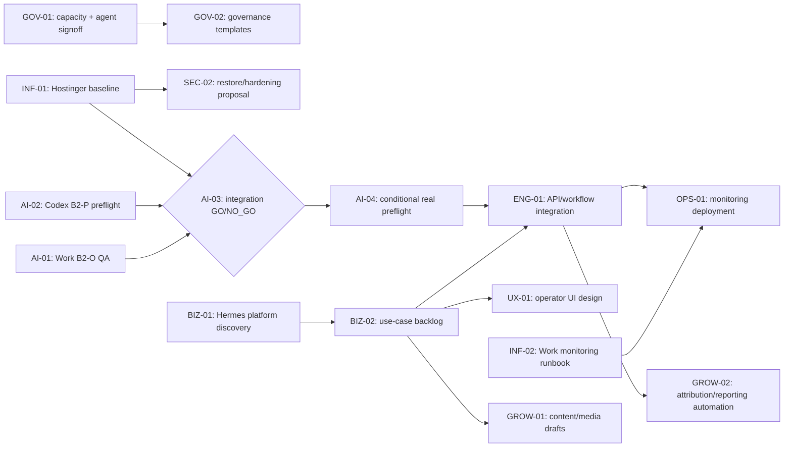

# DRAFT — Kế hoạch công việc tổng thể và phân bổ theo năng lực Agent

**Base snapshot:** `main@a22516aa9e5940baccc37ab2edf9eeed2ccc3d93` (23/11/2026). **Chưa được các Agent xác nhận. Không phải phê duyệt triển khai production hoặc paid API.** ChatGPT chịu trách nhiệm hợp nhất; từng tác nhân chỉ xác nhận phần thuộc năng lực/quyền phiên của mình. Chủ dự án phê chuẩn baseline cuối cùng sau vòng đối chiếu.

## 1. Mục tiêu và nguồn

Mục tiêu: nhìn thấy **toàn bộ việc còn phải làm**, tránh giao trùng; mỗi việc có owner duy nhất, cộng tác viên, mức sẵn sàng, dependency, khả năng song song, điểm nghiệm thu và link evidence. Chia tải theo **năng lực phù hợp và dung lượng thực tế đã ACK**, không chia đều số task một cách cơ học.

Nguồn bắt buộc: [PROJECT](../PROJECT.md), [GOALS_AND_ROADMAP](../GOALS_AND_ROADMAP.md), [Operating Plan](2026-11-21-repository-operating-plan.md), [STATE](../STATE.md), [CATALOG](../CATALOG.yaml), [AGENTS](../AGENTS.md), [Workflow §§7–10](../rules/AGENT_WORKFLOW.md), [Security](../rules/REPOSITORY_SECURITY.md), [Agent directory](../agents/README.md), [ADR-P0-003](../decisions/2026-11-21-hermes-gate-b-single-paid-call-proposal.md). Các task đã tồn tại là nguồn điều khiển chi tiết; tài liệu này là **portfolio index**, không ghi đè quyền hoặc status của task gốc. Trước khi ACK, mỗi Agent phải fetch **main + PR heads mới nhất**, đọc đủ các tài liệu liên quan, nêu SHA/độ lệch với snapshot và không lấy snapshot làm bằng chứng live.

## 2. Phạm vi và cấu trúc hệ thống

**Giai đoạn 0** (21/11–05/12/2026): governance, capability, health baseline, topology, an toàn, chuẩn bị hợp đồng tích hợp. **Giai đoạn 1** (06/12/2026–04/01/2027): reliability, monitoring, backup/restore an toàn, idempotency/error handling. **Giai đoạn 2** (05/01–19/02/2027): media, Ads, website/SEO, đa kênh, báo cáo đo lường và workflow kinh doanh. Đây là khung mục tiêu từ roadmap, **không phải cam kết tiến độ**; kiểm tra dependency và năng lực thực tế trước khi xếp lịch.

Năm workstream đang có: **WS-01 governance; WS-02 infrastructure reliability; WS-03 AI integration; WS-04 website/content/media/growth; WS-05 security/data governance**. Thêm một lớp năng lực dùng chung: **UI/operator console** là đề xuất thuộc WS-03/WS-04, chưa có task/approval triển khai.

Phân biệt: **Hermes Agent WebUI** (có công cụ và đã thử GitHub) khác **Hermes auxiliary/runtime production** (chưa có paid E2E hoàn tất); **Hostinger Agent** khác nền tảng Hostinger; **n8n không phải AI Agent**, là execution plane cần owner kỹ thuật quản lý. **ChatGPT Work** là môi trường tác vụ trong ChatGPT, chưa có hồ sơ năng lực/ACK riêng trong repo; phân công dưới đây là **provisional**, phải tự xác minh phiên GitHub, quyền đọc/ghi và giới hạn.

## 3. Bản đồ thế mạnh và giới hạn — cần từng Agent xác nhận

| Agent | Sở trường phù hợp đã ghi nhận | Chưa chứng minh / không tự cấp quyền | Khối công việc ưu tiên | Trạng thái xác nhận kế hoạch |
|---|---|---|---|---|
| ChatGPT Điều phối | Mục tiêu, kiến trúc nghiệp vụ, backlog, thiết kế acceptance, review evidence, Git docs | Không chạy nền, không VPS shell tự động, không phê duyệt chi phí thay owner | WS-01, nghiệm thu chéo, dependency/capacity | DRAFT_AUTHOR_ONLY |
| Codex | Code/API/Compose/Docker, test/mock/E2E, rollback và Git; phiên khảo sát có công cụ kỹ thuật | Quyền VPS theo phiên; không có Ads/media API production đã kiểm, không tự đổi production | WS-03 kỹ thuật, CI/test, adapter và UI sau gate | PENDING_AGENT_ACK |
| Hermes Agent (WebUI) | Research, reasoning, tools, content/media brief, Git reporting; khảo sát có 55 skills | Không chứng minh Ads/YouTube/WordPress connector live hoặc automation 24/7; Hermes auxiliary ≠ WebUI | WS-04 discovery/content, QA nghiệp vụ, schema/tool research | PENDING_AGENT_ACK |
| Hostinger Agent | hPanel, VPS/backup/domain/DNS/WordPress account inventory, tài liệu hosting, Git | Không điều khiển Hermes/n8n private nếu chưa có tool; không tự deploy production | WS-02 baseline, WS-05 hạ tầng, web hosting | PENDING_AGENT_ACK |
| ChatGPT Work | Được đề xuất làm reviewer nguồn và viết runbook/đánh giá độc lập theo task hiện hành | Chưa có capability survey độc lập; quyền truy cập theo phiên phải ACK | QA độc lập B2, runbook WS-02, ma trận kiểm thử/UX audit | PENDING_CAPABILITY_SURVEY_AND_ACK |
| n8n (thành phần) | Trigger, webhook, scheduling, execution state, connector theo workflow | Production hiện 0 workflows/MCP tắt trong audit; không có khả năng tự nghiệm thu Git | Runtime cho WS-03/04 khi workflow đã được triển khai an toàn | NOT_AN_AGENT; Codex owner kỹ thuật |

Nếu Agent thiếu quyền/công cụ, ghi `BLOCKED_ACCESS` đúng mục, đề xuất hoán đổi theo năng lực thay vì tiếp tục giao vì mục tiêu chia đều. Mỗi Agent báo **công suất đồng thời ước tính theo task/phiên**, thời gian khả dụng thực tế (nếu biết), constraints và loại đầu ra kiểm chứng được. Không suy luận một Agent online 24/7.

## 4. Master backlog — đề xuất; không mở task trùng

Mỗi dòng có một owner chịu trách nhiệm; `||` nghĩa là có thể chạy đồng thời với dòng cùng wave nếu không tranh chấp WRITE_SET, runtime, ngân sách hoặc approval. Trạng thái kế hoạch không thay trạng thái thực trong task gốc.

| ID / WS | Công việc và nguồn | Owner / hỗ trợ | Dependency và gate | Wave / song song | Trạng thái tại snapshot / đầu ra nghiệm thu |
|---|---|---|---|---|---|
| GOV-01 / 01 | Rà soát đủ backlog, năng lực, cân tải, nhất trí kế hoạch (tài liệu này) | ChatGPT / tất cả Agent | Rule ACK từng bên; owner final review | W0 || mọi task read-only đã có | DRAFT; sign-off matrix + issue list |
| GOV-02 / 01 | Chuẩn metadata task/report, link state/catalog, validator/CI đề xuất ([Operating Plan](2026-11-21-repository-operating-plan.md)) | ChatGPT Work (đề xuất) / Codex | Work survey; GitHub policy/change approval nếu bật CI | W1 || INF-01, AI-02 | PLANNED; validator spec/test fixtures; không sửa rule trước review |
| INF-01 / 02 | hPanel baseline KVM2/health/Docker/firewall/HTTPS/backup ([task](2026-11-22-hostinger-ws02-infrastructure-baseline.md)) | Hostinger Agent | Có quyền đọc hPanel; không đổi runtime | W0 || AI-01, INF-02 | PREPARED_FOR_OWNER_FORWARD; PR riêng, VERIFIED_LIVE theo từng tín hiệu |
| INF-02 / 02 | Monitoring/triage runbook và 3 ca giả ([task](2026-11-22-work-ws02-monitoring-and-triage.md)) | ChatGPT Work | Work capability + GitHub; không đợi INF-01 | W0 || INF-01, AI-01 | PREPARED_FOR_OWNER_FORWARD; runbook + PR riêng |
| AI-01 / 03 | Work review O1–O4 B2-O trên PR #4 (đã có task và tiêu chí) | ChatGPT Work | B2-O `d95f161`, review comments PR #5 | W0 || INF-01/02, AI-02 | PENDING; verdict evidence, không chạy lại B2-N đã PASS |
| AI-02 / 03 | Codex B2-P KVM2 **read-only preflight + fake-only candidate** ([Gate B task](2026-11-21-hermes-gate-b-one-shot-paid-e2e.md)) | Codex / Hostinger cung cấp baseline | Review ba comment PR #5; chỉ đọc KVM2 nếu có quyền; không up/apply | W0 || INF-01/02, AI-01 | PREPARED_FOR_OWNER_FORWARD; rendered no-overlap/health/owner/rollback |
| AI-03 / 03 | Review và quyết định có mở fixture KVM2 hay không | ChatGPT / Codex, Work | AI-01 + AI-02; INF-01 khi liên quan health/headroom | W1 sau gate | BLOCKED_BY_EVIDENCE; quyết định riêng; giữ live NO_GO |
| AI-04 / 03 | Real IPC/ledger/bridge/Guard/paid preflight; điều kiện một Hermes paid attempt | Codex / Hostinger, Hermes; ChatGPT review | AI-03, ADR-P0-003, tất cả safety/cost gates | W2 **không** song song với thay đổi production/KVM2 | BLOCKED_PREFLIGHT; không dispatch/retry provider |
| SEC-01 / 05 | Threat model, data classification, secrets/retention, RBAC, public Git safety | Hostinger Agent (infra) / ChatGPT Work (independent review), Codex | Dùng security review hiện có; read-only | W1 || GOV-02, BIZ-01 | PLANNED; ma trận risk/owner/approval; không hardening live |
| SEC-02 / 05 | Kế hoạch hardening, backup restore drill không phá hủy | Hostinger Agent / Codex review | INF-01 + SEC-01 + approval riêng mọi action live | W2 sau gate | PLANNED; runbook + rollback, không apply |
| BIZ-01 / 04 | Khảo sát có chứng cứ các kênh Ads, WordPress, YouTube, TikTok, Meta, media, GA4: API/tools, scope/quota | Hermes Agent / Hostinger (WP), ChatGPT tổng hợp | Chỉ đọc docs/metadata đã được phép; chưa phải kết nối account | W0 || AI-01/02, INF-01/02 | PLANNED; capability matrix per platform, VERIFIED/DOCUMENTED/UNKNOWN |
| BIZ-02 / 04 | Business use-case backlog: media, ads measurement, SEO, ecommerce, reporting; KPI/acceptance ưu tiên | ChatGPT / Hermes, Work | PROJECT + BIZ-01 cho feasibility; có thể lập bản draft trước | W1 || SEC-01, GOV-02 | PLANNED; workflow opportunity register, không Ads/website write |
| UX-01 / 03/04 | Operator UI/agent workflow designer: thông tin, role/permissions, trạng thái, audit, approval, mock | ChatGPT Work (đề xuất) / Hermes UX review, Codex feasibility | GOV-01 + user stories BIZ-02; Work capability survey | W1 || SEC-01 | PLANNED; wireframe/spec độc lập, không tự triển khai UI live |
| ENG-01 / 03 | Kiến trúc connector, durable job state, event/deadline/callback, monitoring, n8n workflows | Codex / Hermes (semantic), Work QA | AI-03/04 theo scope; BIZ-01; security model | W2 theo từng connector sau gate | PLANNED; sandbox tests, không tích hợp account nếu thiếu quyền |
| GROW-01 / 04 | Media/content preproduction và SEO/social briefs, mẫu QA/publish workflow | Hermes Agent / ChatGPT Work QA | BIZ-02; assets/copyright/permissions | W1 || SEC-01/UX-01 | PLANNED; brief, draft, rubric; chưa tạo chi phí/publish |
| GROW-02 / 04 | Đo attribution, source/lead, quảng cáo và báo cáo dashboard theo dữ liệu có quyền | ChatGPT Work (đề xuất) / Hermes, Codex | BIZ-01, consent/access, BIZ-02, ENG-01 nếu tự động | W2 || một số media draft | PLANNED; tracking plan, mock report; không thay Google Ads |
| OPS-01 / 02/03 | Scheduler, alerting, on-call/escalation, replay và incident log | Codex / Hostinger, Work | INF-01/02, ENG-01, gate của từng environment | W2 sau gate | PLANNED; sandbox implementation + monitoring evidence |
| QA-01 / cross | Regression, adversarial negative cases, UX/security QA độc lập mỗi release | ChatGPT Work / ChatGPT final gate | Mỗi deliverable cần phiên/đầu vào cụ thể; không tự chạy production | Mọi wave, không block việc độc lập khác | PLANNED; review matrix theo diff, không lặp PASS |

**Danh sách trên là portfolio dự kiến, không khẳng định đã liệt kê hết mọi task trong CATALOG.** Trước baseline final: so khớp mọi `tasks/` có status `ready/in_progress/blocked/prepared`; gắn `existing_task_path`, owner, dependencies và tiến độ thật; tạo dòng bổ sung nếu thiếu, không tạo task mới khi task gốc bao phủ. Các công việc kinh doanh giai đoạn 2 vẫn là backlog thiết kế, chưa ủy quyền kết nối/publish.

## 5. Dependency graph và phân luồng



**W0 ngay trong quyền có sẵn:** GOV-01 (ChatGPT), AI-01 và INF-02 (Work, hai đầu ra độc lập nhưng cần tự báo giới hạn công suất), AI-02 (Codex), INF-01 (Hostinger), BIZ-01 (Hermes). **W1:** GOV-02, SEC-01, BIZ-02, UX-01, GROW-01. **W2:** AI-04, SEC-02, ENG-01, OPS-01, GROW-02 phụ thuộc gate cụ thể. Không được diễn giải W2 là permission để triển khai.

## 6. Cân tải và chống điểm nghẽn

Đặt **owner duy nhất** cho mỗi task, tối đa **1 task thực thi rủi ro cao hoặc 2 task read-only/draft đang active mỗi Agent** như ngưỡng điều phối **đề xuất**, không phải năng lực đo được. Agent tự ghi mức thực tế qua ACK; ChatGPT điều chỉnh wave, không ép nhận task ngoài thế mạnh. Reviewer phải khác implementer cho các gate quan trọng; nếu same platform không độc lập thật phải công bố. Work có hai nhiệm vụ W0 đang có; **không giao GOV-02/UX-01/QA-01 đồng thời cho Work** trước khi Work hoàn thành/ACK công suất. Codex giữ AI-02, không ôm SEC-01 hay tài liệu BIZ-01. Hermes có đường việc giá trị độc lập ngay W0 (BIZ-01); Hostinger có INF-01. ChatGPT không thay Codex viết mã hay Hostinger đo hPanel.

Mỗi review capacity ghi: `max_concurrent`, `session_access`, `skills_verified_with_evidence`, `willing_to_own`, `cannot_own`, `dependencies`, `alternative_owner`. Nếu Agent không có session được khởi tạo, trạng thái `PREPARED_FOR_OWNER_FORWARD`, không tự nói agent đang rảnh/đang làm.

## 7. ĐẶC TẢ CHUNG DUY NHẤT — gửi nguyên văn cùng một URL cho mọi Agent

**Dành đồng thời cho:** Codex, Hermes Agent WebUI, Hostinger Agent và ChatGPT Work. **Không có thứ tự Codex trước rồi Agent khác sau.** Mọi Agent nhận **cùng một nhiệm vụ review, cùng một PR #6, cùng một biểu mẫu trả lời** và làm song song, không đợi kết quả nhau. ChatGPT Điều phối là người tổng hợp duy nhất, không tự ký ACK thay bất kỳ Agent nào. n8n là thành phần phần mềm, không cần giả vờ ký xác nhận như AI Agent.

**LINK DUY NHẤT:** https://github.com/DuyKienTTD/Hosting/pull/6

**TASK ID chung:** `ttd-multi-agent-master-allocation-2026-11-23`
**Mục tiêu chung:** phản biện và hoàn thiện toàn bộ danh mục công việc, phân bổ đúng Agent theo năng lực thật, đủ việc độc lập để triển khai đồng thời, tránh dồn Codex và tránh Agent bị nhàn rỗi do phụ thuộc giả.
**Trạng thái:** `PREPARED_FOR_OWNER_FORWARD`; một owner duy nhất cho **mỗi lượt review** là chính Agent nhận URL này; ChatGPT owner hợp nhất cuối. Tệp kế hoạch vẫn DRAFT cho tới khi đủ các ACK.

### A. FIRST ACTION — mọi Agent áp dụng giống nhau

1. Fetch `main` và head của PR #6, ghi SHA thực đọc; đọc **đủ** `AGENTS.md`, `PROJECT.md`, `GOALS_AND_ROADMAP.md`, `rules/AGENT_WORKFLOW.md` §§7–10, `rules/REPOSITORY_SECURITY.md`, `STATE.md`, `CATALOG.yaml`, `agents/README.md`, **hồ sơ chính Agent**, tài liệu này và task/evidence liên quan đến các dòng đang kiểm. Nếu kết quả bị cắt, đọc phần còn thiếu; nếu không thể đọc đủ thì báo `PARTIAL_READ`, không xác nhận vô điều kiện.
2. Tự nhận diện đúng môi trường: Codex kỹ thuật, Hermes WebUI, Hostinger Agent hPanel, hay ChatGPT Work. Kiểm chứng công cụ và quyền thực tế **trong phiên hiện tại**, phân biệt `VERIFIED`, `REPORTED`, `AVAILABLE_UNTESTED`, `UNKNOWN/BLOCKED`. Không nhầm backend/runtime production với WebUI/session.
3. Đọc **toàn bộ bảng backlog, sơ đồ dependency, waves và capacity**, không chỉ dòng gắn tên mình. Đối chiếu với danh mục task đang mở và mốc PASS đã có để tìm thiếu/trùng, các nhiệm vụ có thể tách song song, dependency giả và điểm nghẽn.
4. Tự xác nhận hoặc đề xuất sửa **các dòng mình làm owner, các dòng mình hỗ trợ, và các dòng cần agent khác làm tốt hơn**. Nêu năng lực/chứng cứ cụ thể; phân loại công việc nào có thể bắt đầu ngay ở chế độ read-only/draft, việc nào cần quyền/gate, việc nào không khả thi trong phiên.
5. Ghi khả năng tải công việc có căn cứ: giới hạn đồng thời hợp lý, loại công việc chính/phụ, những tác vụ có thể triển khai song song, reviewer thay thế, và kiến nghị chuyển owner để tối ưu critical path. Không tối ưu theo số task bằng nhau; tối ưu thời gian hoàn thành tổng thể và quality gates.
6. Phản biện tiêu chí nghiệm thu, first action, READ_SET/WRITE_SET, STOP, dữ liệu và quyền; đánh dấu rõ mỗi claim chưa đủ evidence. **Không chạy chính các task đang được đánh giá trong lượt review kế hoạch này.**
7. Trả về **một ACK + một verdict thống nhất** theo mẫu dưới, trên comment/review PR #6 hoặc report đã khử nhạy cảm dẫn URL và SHA, không cần lập task/PR mới chỉ để ký xác nhận. Nếu không có quyền ghi GitHub, trả nội dung ACK trong phiên hiện tại để chủ dự án chuyển tiếp và ghi `NOT_PUSHED`.

### B. Mẫu trả lời chung — các Agent điền một lần

```text
TASK: ttd-multi-agent-master-allocation-2026-11-23
AGENT / SESSION: <agent, environment, checked_at>
REVIEWED: main=<SHA>; PR6=<SHA>; rules=<SHA or ref>; read_status=FULL_READ|PARTIAL_READ
ACK_STATE: ACKNOWLEDGED | BLOCKED_ACCESS  (chỉ khi thực sự nhận được URL)
CAPABILITY: VERIFIED=<skills/tools + evidence>; UNTESTED=<...>; BLOCKED=<...>
OWNERSHIP: ACCEPT=<task IDs>; CHANGE=<task IDs -> proposed owner + reason>; DECLINE=<task IDs + evidence>
DEPENDENCIES: ACCEPT=<IDs>; REMOVE/ADD=<edges + reason>; PARALLELIZE=<IDs>
CAPACITY: max_concurrent=<reasoned range>; active_existing_work=<IDs>; workload_risks=<...>
MISSING_TASKS_OR_DUPLICATES: <IDs, links, concrete correction or NONE_FOUND_WITH_SCOPE>
ACCEPTANCE_OR_SAFETY_GAPS: <specific issues + minimal fix>
VERDICT: ACCEPT_WITH_EVIDENCE | ACCEPT_WITH_CHANGES | REJECT_WITH_REASONS | BLOCKED_ACCESS
EVIDENCE: <GitHub comment URL, report URL/commit or NOT_PUSHED>
NEXT_OWNER: chatgpt
```

**Điều kiện ACCEPT:** không chỉ nói “đồng ý”. Phải có kết luận thực chất về skills/quyền, owner/dependency/tải, và mức độ hoàn chỉnh. Đề xuất chỉnh sửa ghi **hàng/edge cụ thể**, có lý do và owner phù hợp; không sửa trực tiếp tài liệu trung tâm từ các phiên Agent song song để tránh lost updates.

### C. Phân biệt trọng tâm thẩm định, KHÔNG phải bốn lệnh giao riêng

- **Codex:** kiến trúc, code/infra, kiểm thử, critical path, tính khả thi AI-02/ENG-01/OPS-01, hạn mức thay đổi KVM2.
- **Hermes WebUI:** số tools/skills đã xác minh, reasoning, nghiên cứu kết nối, BIZ-01/GROW-01, kỹ năng thực sự dùng được, không tự nhận connector production.
- **Hostinger Agent:** bằng chứng hPanel/VPS/Cloud Hosting/WordPress/backup, INF-01/SEC-01/02, mức truy cập và phân định với Codex.
- **ChatGPT Work:** tự capability survey trong phiên, QA độc lập, monitoring runbook, UX, báo cáo, AI-01/INF-02 và giới hạn công suất trước khi nhận thêm GOV-02/UX-01.
- **ChatGPT Điều phối:** đối chiếu toàn bộ ACK, giải quyết chồng chéo/thiếu việc và cân tải, xác nhận dependency graph không vòng, xác định first safe action từng wave; chỉ sửa kế hoạch sau review.

### D. READ/WRITE/STOP/ACCEPTANCE chung

**READ_SET:** nguồn trong §1, hồ sơ Agent, mọi task/evidence đang review, PR #4/#5 đối với Gate B, PR #6 hiện hành. **WRITE_SET của Agent review:** đúng **một comment/review PR #6** hoặc báo cáo riêng đã khử nhạy cảm nếu comment không khả dụng. **WRITE_SET của ChatGPT:** chỉnh duy nhất kế hoạch PR #6 sau tổng hợp phản hồi; mọi thay đổi rule/index/state là bước riêng sau đồng thuận, không gộp ngầm vào review.

**DO_NOT_TOUCH:** production, KVM2 runtime, Docker, provider/cost, Ads/website/publish, credential, ledger/permit/kill switch, những task Gate B/WS-02 đang chạy, evidence PASS cũ. Review này không cấp thêm quyền hay đổi owner của các task hiện có.

**ACCEPTANCE:** mỗi Agent đã thực sự ACK qua kênh truy xuất được và có verdict cụ thể; ChatGPT tổng hợp discrepancy, cập nhật PR, soát drift/đường găng/xung đột write-set, thu nhận xác nhận lại chỉ với các thay đổi ảnh hưởng trực tiếp, không bắt mọi Agent đọc lại mọi thứ từ đầu. Nếu Agent chưa thể nhận, đánh `PENDING/BLOCKED_ACCESS`, không tự ghi hoàn tất hay coi im lặng là chấp thuận.

**STOP:** thiếu chứng cứ quyền/skill, tài liệu không đọc đủ, nhiệm vụ cần side effect, thông tin nhạy cảm hoặc đề xuất vượt giới hạn ngân sách → dừng đúng phần đó, vẫn hoàn thành nhận xét độc lập khác. Review chỉ đọc, zero USD.

### E. Handoff và phê duyệt hợp nhất

`from_agent=chatgpt; to_agent=Codex|Hermes WebUI|Hostinger Agent|ChatGPT Work (mỗi Agent nhận chung URL, đồng thời); why=independent capability and allocation verification; first_action=§7A; inputs=PR6 + §1; limits=§7D; acceptance=§7B/D; artifact=PR6 comment/review; next_owner=chatgpt; handoff_state=PREPARED_FOR_OWNER_FORWARD`.

Chỉ khi cả bốn Agent trả verdict hoặc blocker cụ thể, ChatGPT mới hợp nhất các đề xuất, tạo bản phân công `APPROVED_ALLOCATION` khi các owner liên quan chấp nhận nhiệm vụ và mọi conflict đã giải quyết. Nếu chưa đủ thì `PARTIALLY_VALIDATED`. Không yêu cầu lượt “Codex review trước” hay bốn prompt riêng; chủ dự án chỉ cần **chuyển cùng URL PR #6 và chỉ dẫn “Thực hiện §7”** tới các phiên Agent có thể sử dụng.

### Ma trận xác nhận — chưa giả định đã giao

| Agent | Trạng thái | Nơi trả kết quả |
|---|---|---|
| Codex | PENDING_NOT_SENT | Comment/review PR #6 |
| Hermes WebUI | PENDING_NOT_SENT | Comment/review PR #6 |
| Hostinger Agent | PENDING_NOT_SENT | Comment/review PR #6 |
| ChatGPT Work | PENDING_NOT_SENT | Comment/review PR #6 |
| ChatGPT Điều phối | AUTHOR / AWAITING_REVIEWS | Tích hợp sau khi nhận |
| n8n | NOT_AN_AGENT | Kiểm thử bởi owner kỹ thuật tương lai |

## 9. Không thay đổi các bất biến hiện có

- Gate B: `LIVE_INTEGRATION_NO_GO`, `BLOCKED_UID_OR_MOUNT`, `PAID_GATE_B_BLOCKED_PREFLIGHT`; không retry/dispatch provider, không unlock global kill switch, không reset ledger.
- B2-N/B2-O đã nghiệm thu trong phạm vi **fake local** theo evidence; PR #5 có review comments cần xử lý theo delta, không mở lại test đã PASS vô lý.
- WS-02 Hostinger/Work và QA B2-O đã có task; tài liệu này không khởi tạo lại.
- Repository public: không secret, IP/host private, raw logs/DB/backup, account identifier.
- Sẵn sàng chịu trách nhiệm không có nghĩa runtime 24/7, connector live, API scope hay quyền production.

## 10. Definition of Done cho tài liệu kế hoạch

DRAFT PR có scope rõ; các Agent xác nhận độc lập theo evidence; xử lý mâu thuẫn; kiểm không task trùng, tải thực tế, dependency không vòng, đủ nguồn `tasks/`; phân định W0/W1/W2 và approval; review thay đổi và security; cập nhật CATALOG/STATE/CHANGELOG + rules/entrypoints sau khi đồng thuận; remote readback. Nếu thiếu ACK thì tài liệu vẫn **DRAFT/PARTIALLY_VALIDATED**, tuyệt đối không báo "tất cả đã nghiệm thu".
