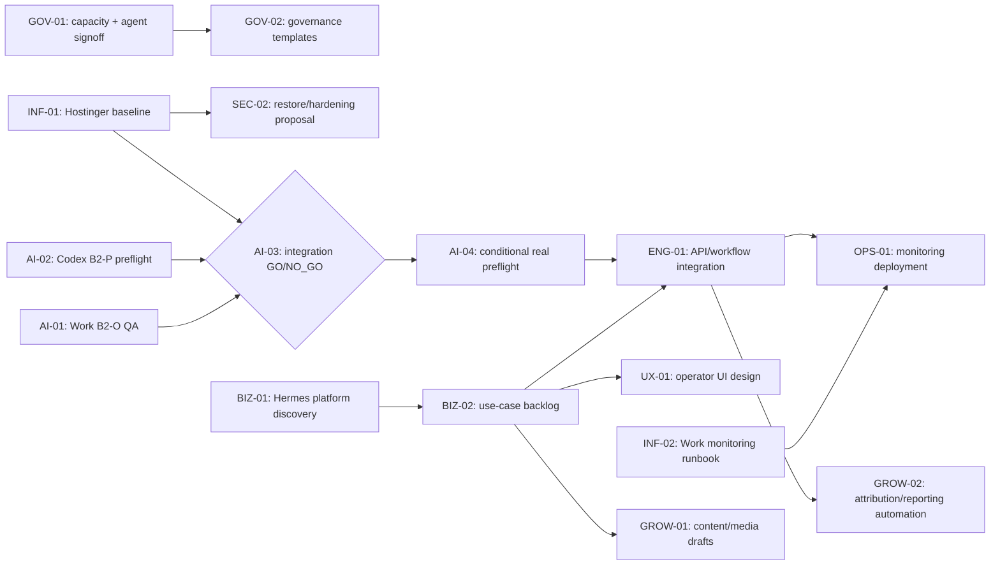

# DRAFT — Kế hoạch công việc tổng thể và phân bổ theo năng lực Agent

**Base snapshot:** `main@a22516aa9e5940baccc37ab2edf9eeed2ccc3d93` (23/11/2026). **Chưa được các Agent xác nhận. Không phải phê duyệt triển khai production hoặc paid API.** ChatGPT chịu trách nhiệm hợp nhất; từng tác nhân chỉ xác nhận phần thuộc năng lực/quyền phiên của mình. Chủ dự án phê chuẩn baseline cuối cùng sau vòng đối chiếu.

## 1. Mục tiêu và nguồn

Mục tiêu: nhìn thấy **toàn bộ việc còn phải làm**, tránh giao trùng; mỗi việc có owner duy nhất, cộng tác viên, mức sẵn sàng, dependency, khả năng song song, điểm nghiệm thu và link evidence. Chia tải theo **năng lực phù hợp và dung lượng thực tế đã ACK**, không chia đều số task một cách cơ học.

Nguồn bắt buộc: [PROJECT](../PROJECT.md), [GOALS_AND_ROADMAP](../GOALS_AND_ROADMAP.md), [Operating Plan](2026-11-21-repository-operating-plan.md), [STATE](../STATE.md), [CATALOG](../CATALOG.yaml), [AGENTS](../AGENTS.md), [Workflow §§7–10](../rules/AGENT_WORKFLOW.md), [Security](../rules/REPOSITORY_SECURITY.md), [Agent directory](../agents/README.md), [ADR-P0-003](../decisions/2026-11-21-hermes-gate-b-single-paid-call-proposal.md). Các task đã tồn tại là nguồn điều khiển chi tiết; tài liệu này là **portfolio index**, không ghi đè quyền hoặc status của task gốc. Trước khi ACK, mỗi Agent phải fetch **main + PR heads mới nhất**, đọc đủ các tài liệu liên quan, nêu SHA/độ lệch với snapshot và không lấy snapshot làm bằng chứng live.

## 2. Phạm vi và cấu trúc hệ thống

**Giai đoạn 0** (21/11–05/12/2026): governance, capability, health baseline, topology, an toàn, chuẩn bị hợp đồng tích hợp. **Giai đoạn 1** (06/12/2026–04/01/2027): reliability, monitoring, backup/restore an toàn, idempotency/error handling. **Giai đoạn 2** (05/01–19/02/2027): media, Ads, website/SEO, đa kênh, báo cáo đo lường và workflow kinh doanh. Đây là khung mục tiêu từ roadmap, **không phải cam kết tiến độ**; kiểm tra dependency và năng lực thực tế trước khi xếp lịch.

Năm workstream đang có: **WS-01 governance; WS-02 infrastructure reliability; WS-03 AI integration; WS-04 website/content/media/growth; WS-05 security/data governance**. Thêm một lớp năng lực dùng chung: **UI/operator console** là đề xuất thuộc WS-03/WS-04, chưa có task/approval triển khai.

Phân biệt: **Hermes Agent WebUI** (có công cụ và đã thử GitHub) khác **Hermes auxiliary/runtime production** (chưa có paid E2E hoàn tất); **Hostinger Agent** khác nền tảng Hostinger; **n8n không phải AI Agent**, là execution plane cần owner kỹ thuật quản lý. **ChatGPT Work** là môi trường tác vụ trong ChatGPT, chưa có hồ sơ năng lực/ACK riêng trong repo; phân công dưới đây là **provisional**, phải tự xác minh phiên GitHub, quyền đọc/ghi và giới hạn.

## 3. Bản đồ thế mạnh và giới hạn — cần từng Agent xác nhận

| Agent | Sở trường phù hợp đã ghi nhận | Chưa chứng minh / không tự cấp quyền | Khối công việc ưu tiên | Trạng thái xác nhận kế hoạch |
|---|---|---|---|---|
| ChatGPT Điều phối | Mục tiêu, kiến trúc nghiệp vụ, backlog, thiết kế acceptance, review evidence, Git docs | Không chạy nền, không VPS shell tự động, không phê duyệt chi phí thay owner | WS-01, nghiệm thu chéo, dependency/capacity | DRAFT_AUTHOR_ONLY |
| Codex | Code/API/Compose/Docker, test/mock/E2E, rollback và Git; phiên khảo sát có công cụ kỹ thuật | Quyền VPS theo phiên; không có Ads/media API production đã kiểm, không tự đổi production | WS-03 kỹ thuật, CI/test, adapter và UI sau gate | PENDING_AGENT_ACK |
| Hermes Agent (WebUI) | Research, reasoning, tools, content/media brief, Git reporting; khảo sát có 55 skills | Không chứng minh Ads/YouTube/WordPress connector live hoặc automation 24/7; Hermes auxiliary ≠ WebUI | WS-04 discovery/content, QA nghiệp vụ, schema/tool research | PENDING_AGENT_ACK |
| Hostinger Agent | hPanel, VPS/backup/domain/DNS/WordPress account inventory, tài liệu hosting, Git | Không điều khiển Hermes/n8n private nếu chưa có tool; không tự deploy production | WS-02 baseline, WS-05 hạ tầng, web hosting | PENDING_AGENT_ACK |
| ChatGPT Work | Được đề xuất làm reviewer nguồn và viết runbook/đánh giá độc lập theo task hiện hành | Chưa có capability survey độc lập; quyền truy cập theo phiên phải ACK | QA độc lập B2, runbook WS-02, ma trận kiểm thử/UX audit | PENDING_CAPABILITY_SURVEY_AND_ACK |
| n8n (thành phần) | Trigger, webhook, scheduling, execution state, connector theo workflow | Production hiện 0 workflows/MCP tắt trong audit; không có khả năng tự nghiệm thu Git | Runtime cho WS-03/04 khi workflow đã được triển khai an toàn | NOT_AN_AGENT; Codex owner kỹ thuật |

Nếu Agent thiếu quyền/công cụ, ghi `BLOCKED_ACCESS` đúng mục, đề xuất hoán đổi theo năng lực thay vì tiếp tục giao vì mục tiêu chia đều. Mỗi Agent báo **công suất đồng thời ước tính theo task/phiên**, thời gian khả dụng thực tế (nếu biết), constraints và loại đầu ra kiểm chứng được. Không suy luận một Agent online 24/7.

## 4. Master backlog — đề xuất; không mở task trùng

Mỗi dòng có một owner chịu trách nhiệm; `||` nghĩa là có thể chạy đồng thời với dòng cùng wave nếu không tranh chấp WRITE_SET, runtime, ngân sách hoặc approval. Trạng thái kế hoạch không thay trạng thái thực trong task gốc.

| ID / WS | Công việc và nguồn | Owner / hỗ trợ | Dependency và gate | Wave / song song | Trạng thái tại snapshot / đầu ra nghiệm thu |
|---|---|---|---|---|---|
| GOV-01 / 01 | Rà soát đủ backlog, năng lực, cân tải, nhất trí kế hoạch (tài liệu này) | ChatGPT / tất cả Agent | Rule ACK từng bên; owner final review | W0 || mọi task read-only đã có | DRAFT; sign-off matrix + issue list |
| GOV-02 / 01 | Chuẩn metadata task/report, link state/catalog, validator/CI đề xuất ([Operating Plan](2026-11-21-repository-operating-plan.md)) | ChatGPT Work (đề xuất) / Codex | Work survey; GitHub policy/change approval nếu bật CI | W1 || INF-01, AI-02 | PLANNED; validator spec/test fixtures; không sửa rule trước review |
| INF-01 / 02 | hPanel baseline KVM2/health/Docker/firewall/HTTPS/backup ([task](2026-11-22-hostinger-ws02-infrastructure-baseline.md)) | Hostinger Agent | Có quyền đọc hPanel; không đổi runtime | W0 || AI-01, INF-02 | PREPARED_FOR_OWNER_FORWARD; PR riêng, VERIFIED_LIVE theo từng tín hiệu |
| INF-02 / 02 | Monitoring/triage runbook và 3 ca giả ([task](2026-11-22-work-ws02-monitoring-and-triage.md)) | ChatGPT Work | Work capability + GitHub; không đợi INF-01 | W0 || INF-01, AI-01 | PREPARED_FOR_OWNER_FORWARD; runbook + PR riêng |
| AI-01 / 03 | Work review O1–O4 B2-O trên PR #4 (đã có task và tiêu chí) | ChatGPT Work | B2-O `d95f161`, review comments PR #5 | W0 || INF-01/02, AI-02 | PENDING; verdict evidence, không chạy lại B2-N đã PASS |
| AI-02 / 03 | Codex B2-P KVM2 **read-only preflight + fake-only candidate** ([Gate B task](2026-11-21-hermes-gate-b-one-shot-paid-e2e.md)) | Codex / Hostinger cung cấp baseline | Review ba comment PR #5; chỉ đọc KVM2 nếu có quyền; không up/apply | W0 || INF-01/02, AI-01 | PREPARED_FOR_OWNER_FORWARD; rendered no-overlap/health/owner/rollback |
| AI-03 / 03 | Review và quyết định có mở fixture KVM2 hay không | ChatGPT / Codex, Work | AI-01 + AI-02; INF-01 khi liên quan health/headroom | W1 sau gate | BLOCKED_BY_EVIDENCE; quyết định riêng; giữ live NO_GO |
| AI-04 / 03 | Real IPC/ledger/bridge/Guard/paid preflight; điều kiện một Hermes paid attempt | Codex / Hostinger, Hermes; ChatGPT review | AI-03, ADR-P0-003, tất cả safety/cost gates | W2 **không** song song với thay đổi production/KVM2 | BLOCKED_PREFLIGHT; không dispatch/retry provider |
| SEC-01 / 05 | Threat model, data classification, secrets/retention, RBAC, public Git safety | Hostinger Agent (infra) / ChatGPT Work (independent review), Codex | Dùng security review hiện có; read-only | W1 || GOV-02, BIZ-01 | PLANNED; ma trận risk/owner/approval; không hardening live |
| SEC-02 / 05 | Kế hoạch hardening, backup restore drill không phá hủy | Hostinger Agent / Codex review | INF-01 + SEC-01 + approval riêng mọi action live | W2 sau gate | PLANNED; runbook + rollback, không apply |
| BIZ-01 / 04 | Khảo sát có chứng cứ các kênh Ads, WordPress, YouTube, TikTok, Meta, media, GA4: API/tools, scope/quota | Hermes Agent / Hostinger (WP), ChatGPT tổng hợp | Chỉ đọc docs/metadata đã được phép; chưa phải kết nối account | W0 || AI-01/02, INF-01/02 | PLANNED; capability matrix per platform, VERIFIED/DOCUMENTED/UNKNOWN |
| BIZ-02 / 04 | Business use-case backlog: media, ads measurement, SEO, ecommerce, reporting; KPI/acceptance ưu tiên | ChatGPT / Hermes, Work | PROJECT + BIZ-01 cho feasibility; có thể lập bản draft trước | W1 || SEC-01, GOV-02 | PLANNED; workflow opportunity register, không Ads/website write |
| UX-01 / 03/04 | Operator UI/agent workflow designer: thông tin, role/permissions, trạng thái, audit, approval, mock | ChatGPT Work (đề xuất) / Hermes UX review, Codex feasibility | GOV-01 + user stories BIZ-02; Work capability survey | W1 || SEC-01 | PLANNED; wireframe/spec độc lập, không tự triển khai UI live |
| ENG-01 / 03 | Kiến trúc connector, durable job state, event/deadline/callback, monitoring, n8n workflows | Codex / Hermes (semantic), Work QA | AI-03/04 theo scope; BIZ-01; security model | W2 theo từng connector sau gate | PLANNED; sandbox tests, không tích hợp account nếu thiếu quyền |
| GROW-01 / 04 | Media/content preproduction và SEO/social briefs, mẫu QA/publish workflow | Hermes Agent / ChatGPT Work QA | BIZ-02; assets/copyright/permissions | W1 || SEC-01/UX-01 | PLANNED; brief, draft, rubric; chưa tạo chi phí/publish |
| GROW-02 / 04 | Đo attribution, source/lead, quảng cáo và báo cáo dashboard theo dữ liệu có quyền | ChatGPT Work (đề xuất) / Hermes, Codex | BIZ-01, consent/access, BIZ-02, ENG-01 nếu tự động | W2 || một số media draft | PLANNED; tracking plan, mock report; không thay Google Ads |
| OPS-01 / 02/03 | Scheduler, alerting, on-call/escalation, replay và incident log | Codex / Hostinger, Work | INF-01/02, ENG-01, gate của từng environment | W2 sau gate | PLANNED; sandbox implementation + monitoring evidence |
| QA-01 / cross | Regression, adversarial negative cases, UX/security QA độc lập mỗi release | ChatGPT Work / ChatGPT final gate | Mỗi deliverable cần phiên/đầu vào cụ thể; không tự chạy production | Mọi wave, không block việc độc lập khác | PLANNED; review matrix theo diff, không lặp PASS |

**Danh sách trên là portfolio dự kiến, không khẳng định đã liệt kê hết mọi task trong CATALOG.** Trước baseline final: so khớp mọi `tasks/` có status `ready/in_progress/blocked/prepared`; gắn `existing_task_path`, owner, dependencies và tiến độ thật; tạo dòng bổ sung nếu thiếu, không tạo task mới khi task gốc bao phủ. Các công việc kinh doanh giai đoạn 2 vẫn là backlog thiết kế, chưa ủy quyền kết nối/publish.

## 5. Dependency graph và phân luồng

**W0 ngay trong quyền có sẵn:** GOV-01 (ChatGPT), AI-01 và INF-02 (Work, hai đầu ra độc lập nhưng cần tự báo giới hạn công suất), AI-02 (Codex), INF-01 (Hostinger), BIZ-01 (Hermes). **W1:** GOV-02, SEC-01, BIZ-02, UX-01, GROW-01. **W2:** AI-04, SEC-02, ENG-01, OPS-01, GROW-02 phụ thuộc gate cụ thể. Không được diễn giải W2 là permission để triển khai.

## 6. Cân tải và chống điểm nghẽn

Đặt **owner duy nhất** cho mỗi task, tối đa **1 task thực thi rủi ro cao hoặc 2 task read-only/draft đang active mỗi Agent** như ngưỡng điều phối **đề xuất**, không phải năng lực đo được. Agent tự ghi mức thực tế qua ACK; ChatGPT điều chỉnh wave, không ép nhận task ngoài thế mạnh. Reviewer phải khác implementer cho các gate quan trọng; nếu same platform không độc lập thật phải công bố. Work có hai nhiệm vụ W0 đang có; **không giao GOV-02/UX-01/QA-01 đồng thời cho Work** trước khi Work hoàn thành/ACK công suất. Codex giữ AI-02, không ôm SEC-01 hay tài liệu BIZ-01. Hermes có đường việc giá trị độc lập ngay W0 (BIZ-01); Hostinger có INF-01. ChatGPT không thay Codex viết mã hay Hostinger đo hPanel.

Mỗi review capacity ghi: `max_concurrent`, `session_access`, `skills_verified_with_evidence`, `willing_to_own`, `cannot_own`, `dependencies`, `alternative_owner`. Nếu Agent không có session được khởi tạo, trạng thái `PREPARED_FOR_OWNER_FORWARD`, không tự nói agent đang rảnh/đang làm.

## 7. Quy trình tất cả Agent thẩm định và ký xác nhận

1. **ChatGPT phát hành DRAFT PR**; không merge hoặc đổi quyền triển khai. Mỗi Agent nhận URL GitHub đúng kênh; nhận được mới đánh `SENT`, có ACK đủ SHA mới đánh `ACKNOWLEDGED`.
2. **Codex review:** kiểm tính khả thi kỹ thuật, dependency/critical path, workload, write-set, nhánh Gate B; nêu năng lực đã verified vs unavailable và sửa đề xuất owner nếu cần. **Không chạy KVM2 từ việc review này.**
3. **Hermes Agent WebUI review:** tự đối chiếu tools/skills và GitHub khả dụng theo phiên; chấp nhận/đề xuất sửa BIZ-01, GROW-01 và phần semantic. Không tự nhận Hermes auxiliary inference đã production-ready.
4. **Hostinger Agent review:** tự kiểm capability hPanel/WordPress/VPS và nhịp capacity; xác minh phù hợp INF-01, SEC-01/02; không thao tác thay đổi hạ tầng.
5. **ChatGPT Work review:** trước hết tự ghi capability survey session (GitHub read/write, browsing/review, UI documentation, permission, giới hạn); rồi đánh giá công suất và xung đột AI-01/INF-02/GOV-02/UX-01/QA-01. Nếu không có môi trường Work riêng để ACK, đánh `PENDING`.
6. **ChatGPT đối chiếu phản biện:** tổng hợp ý kiến có bằng chứng và cập nhật tối thiểu kế hoạch trên branch, ghi change log/review table; chủ dự án quyết định nếu có xung đột phạm vi kinh doanh/approval. Chỉ **APPROVED_ALLOCATION** khi mọi Agent tham gia nhận owner đã ACK, conflict giải quyết, dependency graph không vòng, không vượt capacity, mọi item có first action/acceptance và review readback hoàn tất. Nếu một Agent không thể ACK, đánh `PARTIALLY_VALIDATED` và không gán task mới cho Agent đó như đã nhận.
7. **Sau consensus:** mới đưa kế hoạch vào index `CATALOG.yaml`/`STATE.md`, cập nhật rule chung trong `rules/AGENT_WORKFLOW.md` và entrypoints, changelog, review diff đầy đủ rồi merge theo chính sách repo. Việc mở task kỹ thuật tiếp theo vẫn cần gate riêng.

**Mẫu verdict một Agent** (report trên branch/PR riêng hoặc comment có URL và SHA, redacted): `agent; reviewed_plan_sha; rules_sha; actual_session_tools; skill_evidence_urls; rows_accepted; rows_rejected_or_modified; concurrency_limit; dependency_changes; security_scope; verdict=ACCEPT_WITH_EVIDENCE|ACCEPT_WITH_CHANGES|REJECT_WITH_REASONS|BLOCKED_ACCESS; next_owner`. Không tự viết hộ chữ ký/ACK của Agent khác.

### Ma trận chữ ký — CHƯA ĐƯỢC XÁC NHẬN

| Agent | Verdict | Evidence/PR |
|---|---|---|
| ChatGPT Điều phối | AUTHOR_DRAFT; chưa final nghiệm thu | PR kế hoạch này |
| Codex | PENDING | Chưa nhận |
| Hermes WebUI | PENDING | Chưa nhận |
| Hostinger Agent | PENDING | Chưa nhận |
| ChatGPT Work | PENDING_CAPABILITY_SURVEY | Chưa nhận |
| n8n | NOT_APPLICABLE_NOT_AGENT | Do owner kỹ thuật kiểm runtime |

## 8. Handoff đặc tả review (chưa SENT)

`task_id=ttd-multi-agent-master-allocation-2026-11-23`; `from_agent=chatgpt`; `to_agent=<one agent above>`; `why=confirm actual strengths, workload/dependency and feasible ownership`; `first_action=fetch latest main + this PR, read AGENTS/Workflow §§7–10/Security/STATE/CATALOG and your profile, ACK refs`; `inputs=this PR, roadmap, agent directory, task links`; `limits=read-only planning review; no provider/paid, no production, no account writes, no secrets`; `acceptance=verdict with verified tool evidence + rows owned + concurrency + reassignment suggestions`; `artifact=comment/review or redacted report in own PR`; `next_owner=chatgpt`; `handoff_state=PREPARED_FOR_OWNER_FORWARD`.

## 9. Không thay đổi các bất biến hiện có

- Gate B: `LIVE_INTEGRATION_NO_GO`, `BLOCKED_UID_OR_MOUNT`, `PAID_GATE_B_BLOCKED_PREFLIGHT`; không retry/dispatch provider, không unlock global kill switch, không reset ledger.
- B2-N/B2-O đã nghiệm thu trong phạm vi **fake local** theo evidence; PR #5 có review comments cần xử lý theo delta, không mở lại test đã PASS vô lý.
- WS-02 Hostinger/Work và QA B2-O đã có task; tài liệu này không khởi tạo lại.
- Repository public: không secret, IP/host private, raw logs/DB/backup, account identifier.
- Sẵn sàng chịu trách nhiệm không có nghĩa runtime 24/7, connector live, API scope hay quyền production.

## 10. Definition of Done cho tài liệu kế hoạch

DRAFT PR có scope rõ; các Agent xác nhận độc lập theo evidence; xử lý mâu thuẫn; kiểm không task trùng, tải thực tế, dependency không vòng, đủ nguồn `tasks/`; phân định W0/W1/W2 và approval; review thay đổi và security; cập nhật CATALOG/STATE/CHANGELOG + rules/entrypoints sau khi đồng thuận; remote readback. Nếu thiếu ACK thì tài liệu vẫn **DRAFT/PARTIALLY_VALIDATED**, tuyệt đối không báo "tất cả đã nghiệm thu".
